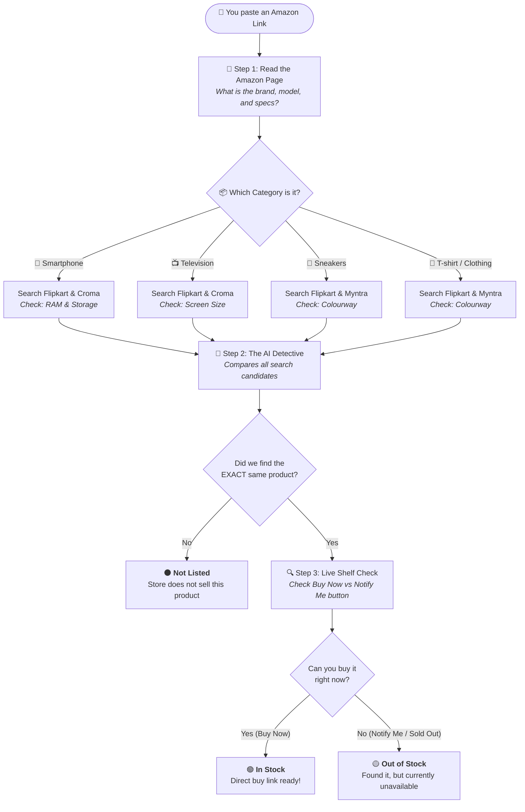
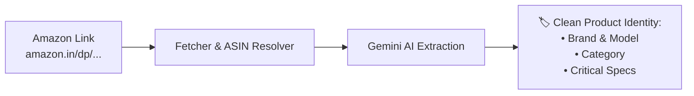
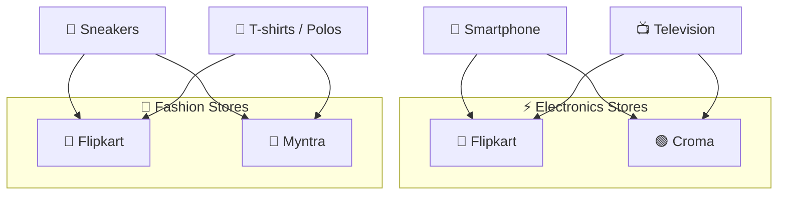
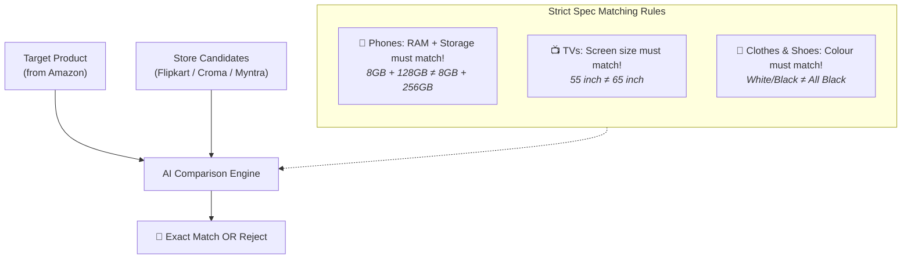
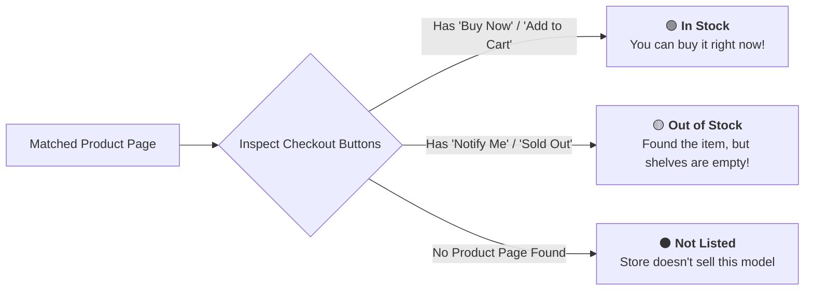

# 🧸 How Product Matching Works
### *Explained Like You're 5 (With Pictures & Flowcharts!)*

---

## 🌟 The Big Idea: The Smart Toy Detective

Imagine you found a toy robot on **Amazon** that you really want. But your mom says: 
> *"Let's check if the toy store down the street (**Flipkart**, **Croma**, or **Myntra**) has the EXACT same robot, and if it's sitting on the shelf ready to buy!"*

Instead of clicking and typing on 10 different websites yourself, our app acts like a **super-fast detective** 🕵️‍♂️ who does it all for you in a few seconds!

---

## 🗺️ How It Works: The Grand Map

---

## 🔍 Step 1: Reading the Amazon Page

When you give us an Amazon link, we open the page and ask our AI (Google Gemini):
> *"Hey detective, what are we looking at? Tell me the brand, model name, and its superpowers!"*

Depending on the product, we zoom in on the rules:
* 📱 **Phone**: How much Brain (**RAM**) and Pocket Space (**Storage**) does it have?
* 📺 **Television**: How big is the glass screen (**Inches**)?
* 👟 **Sneakers & Clothes**: What **Colour** is it?

---

## 🏬 Step 2: Going to the Right Stores

Not all stores sell everything! You wouldn't buy a pair of running shoes at an electronics store, right?

Our app automatically picks the right stores for each category:

---

## 🕵️ Step 3: Comparing Like a Detective

This is the hardest part. Just having a similar name is **not enough**! 

If you want a **Red 128GB iPhone**, and a store offers a **Blue 256GB iPhone**, they are **NOT** the same!

---

## 📦 Step 4: The Live Shelf Check (Stock Status)

Sometimes a store listed a product a year ago, but today the shelves are empty!

We don't want to tell you *"It's available!"* only for you to click and see a sad *"Sold Out"* screen. So our backend visits the matched product page right before answering:

---

## 📋 What You See on Screen

For each store, you get one of three crystal-clear badges:

| Badge | Meaning | What Happens When You Click |
|---|---|---|
| 🟢 **In Stock** | The exact same item is on the shelf and ready to purchase! | Takes you straight to the checkout/product page to buy. |
| 🟡 **Out of Stock** | Found the exact same item, but it is currently sold out or has a "Notify Me" button. | Takes you to the product page so you can click "Notify Me" or track restocks. |
| ⚫ **Not Listed** | This store doesn't sell this specific model or spec configuration. | Keeps you from wasting time searching a store that doesn't have it. |

---

## 💡 Why This Is Smart

Every shopping website formats their names and HTML differently:
* Flipkart writes: `SONY Bravia 2 138.8 cm (55 inch) Ultra HD (4K)`
* Amazon writes: `Sony Bravia 55 inches 4K Ultra HD Smart LED Google TV`
* Croma writes: `Sony Bravia 2 II 140 cm (55 Inch) 4K Ultra HD`

Traditional scraper code breaks whenever a website changes a single button or CSS class name. By combining **targeted e-commerce searches** with **Gemini AI reasoning** and **live button verification**, our system:
1. Understands product variants like a human expert.
2. Respects strict hardware specifications (RAM, storage, screen size, colour).
3. Always gives real, verified stock status!

---

*Built for Scruge — Founding Backend Engineer Assignment*  
*Architecture: Zero external npm dependencies · Node.js HTTP/HTTPS · Google Gemini 2.5/3.5 · Vanilla HTML5/CSS3*
