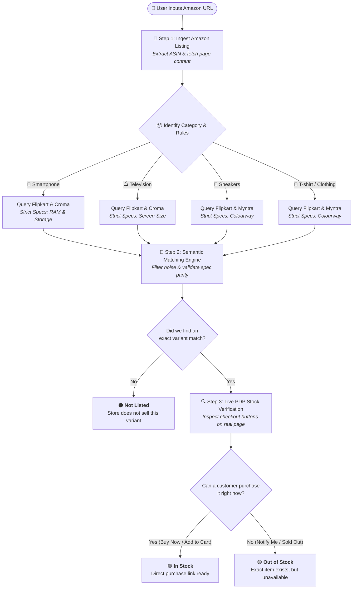
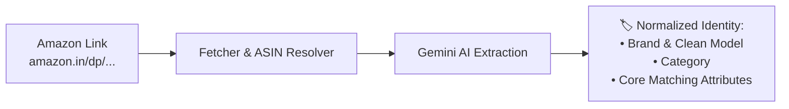
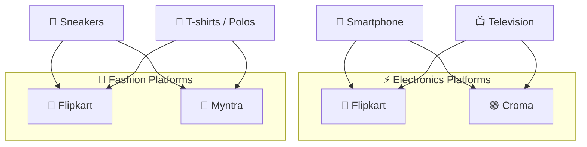
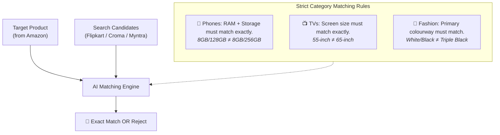
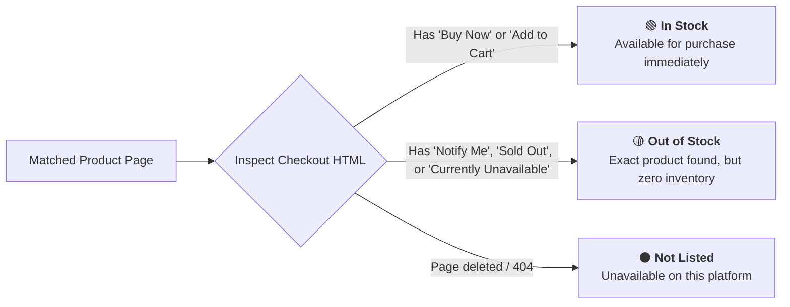

# How Cross-Platform Product Matching Works
### *A plain-English walkthrough of the architecture, matching rules, and edge cases*

---

## 💡 The Problem & My Approach

When you take a product URL from Amazon India and try to find the exact same item on Flipkart, Croma, or Myntra, a simple keyword search almost always fails. In Indian e-commerce:

1. **Titles are cluttered with marketing noise**: Sellers pack titles with unrelated keywords, offers, and warranty text (`"Apple iPhone 15 (128 GB) - Blue | A16 Bionic | Free Earphones Offer | 1 Year Warranty"` vs `"APPLE iPhone 15 (Blue, 128 GB)"`).
2. **Specs change the product entirely**: A 128 GB smartphone is a completely different SKU and price point from a 256 GB variant, even though 95% of the title words are identical.
3. **Online vs Retail Model Suffixes**: Brands like Sony often assign different model numbers to online-exclusive listings vs retail store shelves (e.g. `KD-55X74L` on Amazon vs `KD-55X75L` on Croma), even though the panel, processor, and hardware are 100% identical.
4. **Phantom Listings**: A product might have a search result or indexed page, but be completely out of stock or unorderable when you click it.

To solve this cleanly without any bulky third-party scraping libraries, I designed a lightweight 4-step pipeline: **Normalize Amazon Input → Route to Platforms → Semantic Match with Gemini → Live Stock Verification**.

---

## 🗺️ High-Level System Flowchart

---

## 🔍 Step 1: Normalizing the Amazon Link

When a user submits an Amazon link, the first task is getting clean, structured metadata without being tricked by tracking tags or bloated page HTML.

1. **ASIN Extraction**: Amazon links contain lots of dynamic query parameters (`ref=`, `qid=`, `dib=`). I strip these out to grab the clean 10-character Amazon ASIN (`B0...`), and fetch Amazon's lightweight mobile product page (`/gp/aw/d/ASIN`). This returns the core product details in a fraction of the time and size of the desktop site.
2. **Attribute Extraction with Gemini**: The fetched HTML is passed through Gemini to extract a clean JSON profile:
   - **Brand & Model**: e.g., `Apple`, `iPhone 15`
   - **Category**: `SMARTPHONE`, `TELEVISION`, `SNEAKERS`, or `CLOTHING`
   - **Category-Specific Specs**:
     - *Smartphones*: Physical base RAM and internal storage (filtering out marketing terms like "virtual RAM").
     - *Televisions*: Display size in inches (normalizing `138.8 cm` to `55"`).
     - *Fashion*: Primary base colourway.

---

## 🏬 Step 2: Routing to the Right Platforms

Rather than making unnecessary network calls to all platforms, the system routes queries based on category rules:

- **Smartphones & Televisions** ➔ Query **Flipkart** & **Croma**.
- **Sneakers & Clothing** ➔ Query **Flipkart** & **Myntra**.

To keep search reliable across different platform indexing quirks, I run multiple search strategies concurrently:
1. Direct store search endpoints / SSR search markup.
2. Targeted index search queries (`site:croma.com`, `site:myntra.com`) so we find the product even when internal search bars fail on specific model codes.

---

## 🧠 Step 3: Exact Semantic Matching Rules

Search engines return candidates that are *relevant*, but they rarely guarantee an *exact SKU match*. This is where my matching engine evaluates each candidate against strict category requirements:

### Category Rules I Enforce:
1. **Smartphones (RAM + Storage)**:
   - Both RAM and internal storage must match the Amazon product.
   - A 128 GB phone is never matched with a 256 GB variant.
   - If a brand advertises "12 GB RAM" on one site (6 GB hardware + 6 GB software expansion) and "6 GB RAM" on Amazon, the prompt normalizes to the physical hardware spec so they match correctly.
2. **Televisions (Screen Size & Sister Models)**:
   - Screen size in inches must match identically (a 55" TV cannot match a 65" TV).
   - **Sister Model Support**: I added logic for retail channel sister models. For example, Sony sells `KD-55X74L` on Amazon/Flipkart and `KD-55X75L` on Croma. They share identical hardware, panel, and firmware; my system recognizes them as an exact match while rejecting different series (`X74L` vs `X80L`).
3. **Sneakers & Clothing (Colourway)**:
   - The primary colourway must match. A `White/Navy` sneaker cannot match a `Triple Black` version of the same shoe.
   - Minor packaging differences or promotional bundles do not invalidate the match.

If no candidate satisfies these strict criteria, the system reports **⚫ Not Listed**.

---

## 📦 Step 4: Live Stock Verification (Real-Time Availability)

Finding a matching URL is not enough. E-commerce platforms often keep index pages active long after an item sells out.

Before returning any match to the user, my backend visits the live Product Detail Page (PDP) to inspect current buyability:

### Real-World Edge Cases Handled:
- **Croma SSR Pincode State**: Croma's initial server-rendered HTML renders disabled button markup before client JavaScript hydrates the user's location. Rather than relying on fragile CSS class names, my stock checker inspects definitive availability signals (`Notify Me`, `Sold Out`, `Currently Unavailable`).
- **Flipkart Seller Stock**: Flipkart marks items as "Sold Out" or "Currently Out of Stock" when warehouse inventory in a region is exhausted.
- **Myntra Size Matrix**: A clothing or shoe item is only flagged as in-stock if there is at least one active, purchasable size.

---

## 📊 Summary of Output Badges

| Badge | Status | Meaning | What Happens When Clicked |
|---|---|---|---|
| 🟢 | **In Stock** | The exact product and spec is available to purchase right now. | Opens the direct product page ready for checkout. |
| 🟡 | **Out of Stock** | Found the exact product match, but it is currently sold out or has a "Notify Me" button. | Opens the product page so the user can track restocks. |
| ⚫ | **Not Listed** | The platform does not sell this specific model or spec. | Prevents the user from wasting time looking for it. |

---

## 🛠️ Architecture & Engineering Notes

- **Zero External Dependencies**: The entire backend is built using native Node.js core modules (`http`, `https`, `crypto`, `fs`). No Cheerio, Puppeteer, or Express packages required.
- **Resilient AI Calling**: Calls to Gemini include automated exponential backoff and seamless fallback from `gemini-3.8-flash` to `gemini-3.5-flash-lite` in case of rate limits.
- **Live Debugging & Observability**: Includes an in-memory rolling log buffer at `/api/debug` and a version endpoint at `/api/version` so system decisions and scraping traces can be monitored in real time.

---

*Author: Shlok Dubey*  
*Submission for Scruge Founding Backend Engineer Assignment*
